<picture>
  <source media="(prefers-color-scheme: dark)" srcset="./dark.svg">
  <source media="(prefers-color-scheme: light)" srcset="./light.svg">
  
</picture>

  

  <strong>Thoughtful software. Real-world impact.</strong> 
  ENGINEERING &nbsp; / &nbsp; PRODUCT &nbsp; / &nbsp; SYSTEMS

  <a href="https://purplestarsystems.com">Purple Star ↗</a> &nbsp; · &nbsp;
  <a href="https://github.com/bhpranit08">Explore my work ↗</a>

---

## Building software for everyday business operations

I'm **Pranit Bhandari**, founder of **Purple Star Private Limited**, based in Kathmandu, Nepal. I build full-stack software and study AI, with a focus on turning complex business workflows into maintainable products.

My work spans software engineering, product architecture, and working directly with the people using what I build.

### Currently building

**Purple Star Dealer Management System** — a multi-tenant platform for importers and dealerships.

- **Operations:** inventory, sales, requisitions, and service workflows.
- **Business management:** CRM, HR, and accounts.
- **Architecture:** tenant-scoped data, role-based access, and shared product capabilities across businesses.

I aim to build configurable, reusable capabilities that remain useful as the product and its customers grow.

### Engineering stack

| Area | Technologies |
| --- | --- |
| Frontend | React, Vite, Tailwind CSS |
| Backend | Node.js, Express |
| Database | MongoDB, Mongoose |
| Deployment & operations | Linux, Nginx, PM2 |
| Other experience | PHP, LAMP |

### Beyond the code

Studying AI, building a software business, and making time for mountain biking and the gym.

### Connect

[Purple Star](https://purplestarsystems.com) · [GitHub](https://github.com/bhpranit08)
